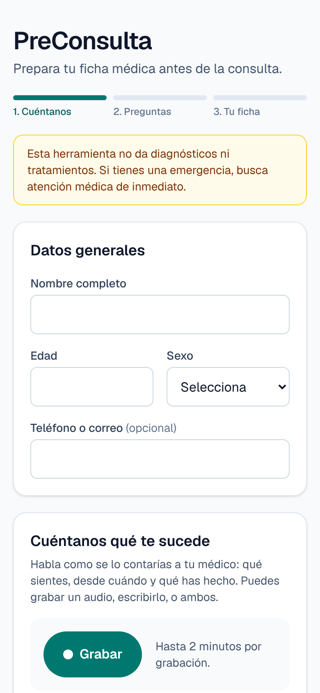
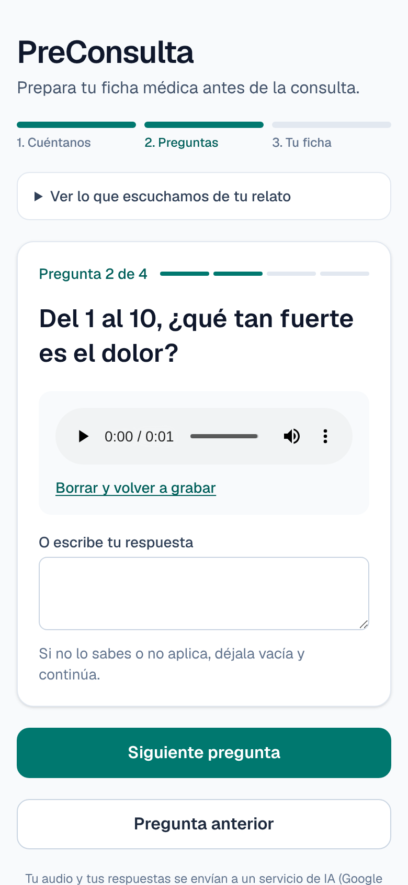
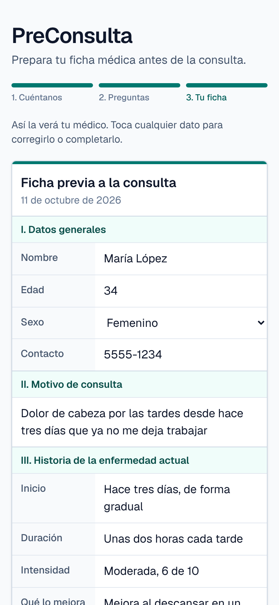
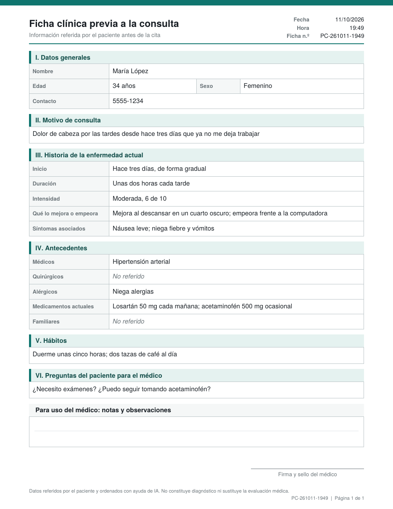
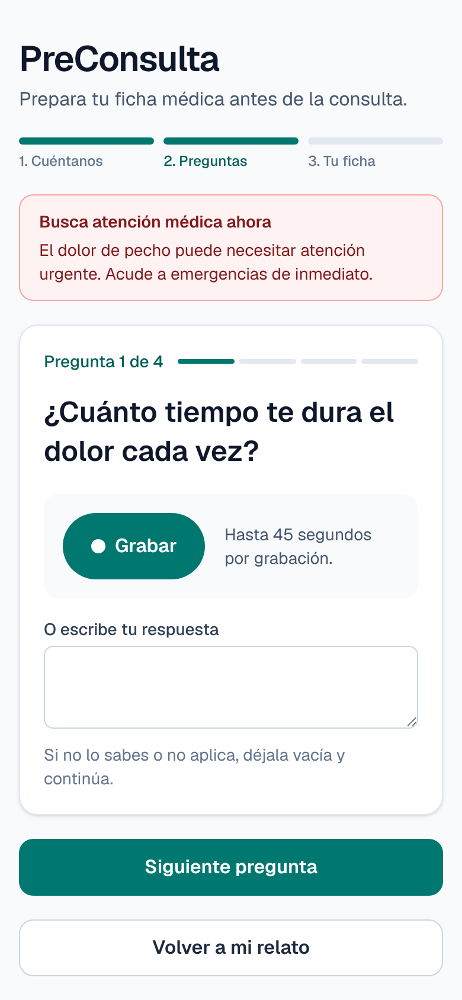
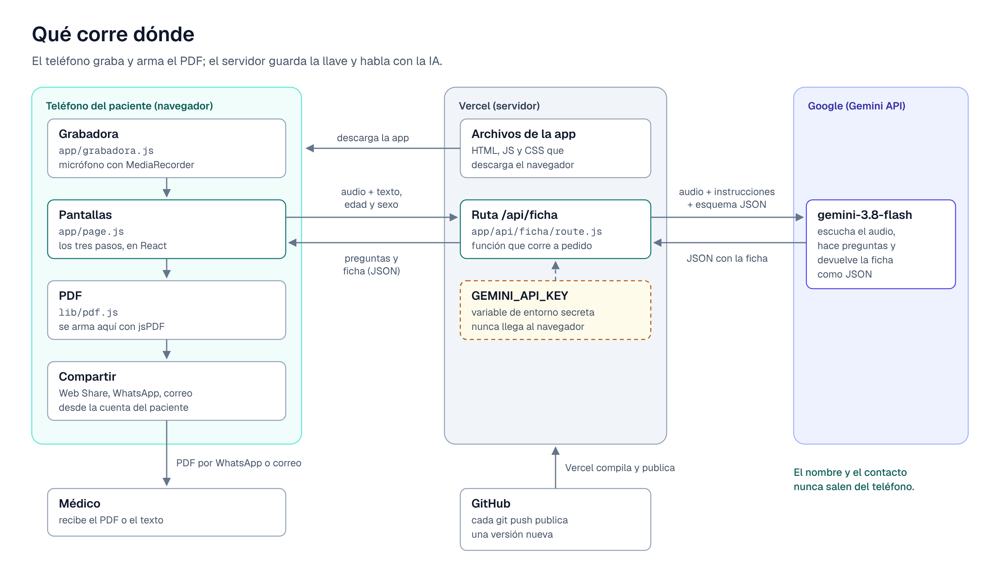
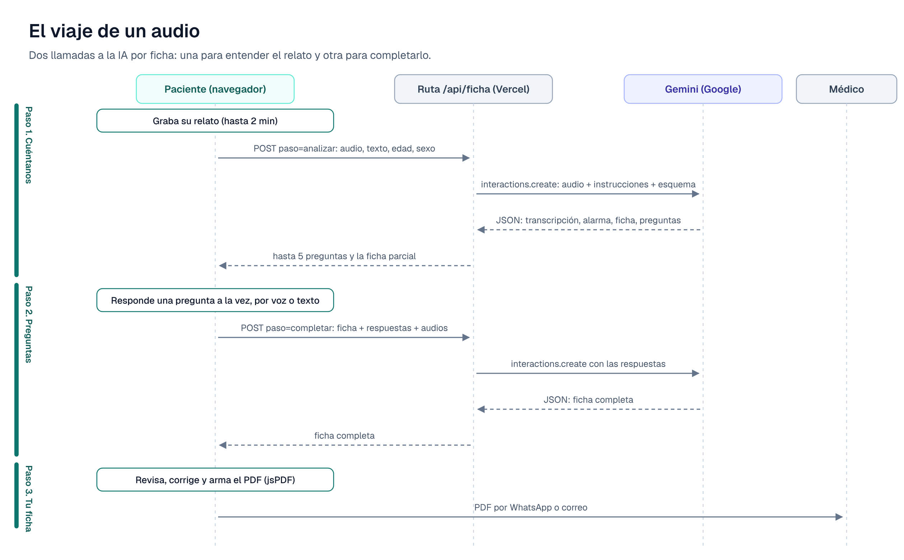

# PreConsulta

**Convierte un audio en una ficha médica ordenada antes de la consulta.** El paciente cuenta con su voz qué le pasa, una IA le hace unas cuantas preguntas de seguimiento y el resultado es una ficha estándar en PDF, lista para enviar al médico.

**Demo:** https://preconsulta-iota.vercel.app/ · **Artículo:** [De un audio a una ficha médica](ENLACE_DEL_ARTICULO) · **English:** [README.md](README.md)

> PreConsulta no diagnostica ni recomienda tratamientos: solo ordena lo que dice el paciente. Todas las capturas usan datos inventados.

<p>
  
  
  
</p>

## Qué hace

1. **Cuéntanos.** El paciente llena sus datos generales y graba hasta 2 minutos contando qué le pasa, o lo escribe.
2. **Preguntas.** La IA escucha, detecta lo que falta y hace hasta 5 preguntas, una a la vez. Cada una se responde con un audio corto (hasta 45 segundos) o por escrito, o se deja vacía.
3. **Tu ficha.** Las respuestas regresan como una hoja clínica que el paciente corrige tocando cualquier dato. Se comparte como PDF desde el menú del teléfono (WhatsApp, correo…), se descarga o se envía como texto.

Si el paciente describe una señal de alarma, como dolor de pecho, la app muestra un aviso en rojo para buscar atención de emergencia.

<p>
  
  
</p>

## Qué corre dónde y por qué



| Parte | Dónde corre | Por qué ahí |
| --- | --- | --- |
| Pantallas (`app/page.js`) | Navegador del paciente | La app se abre con un enlace en cualquier teléfono, sin instalar nada |
| Grabadora (`app/grabadora.js`) | Navegador del paciente | El navegador ya trae una API de micrófono (`MediaRecorder`) |
| PDF (`lib/pdf.js`) | Navegador del paciente | La ficha no necesita volver a un servidor para convertirse en archivo |
| Compartir | Navegador y apps del paciente | Se envía desde la cuenta de WhatsApp o correo del propio paciente |
| Ruta `/api/ficha` (`app/api/ficha/route.js`) | Vercel, como función serverless | Es el único lugar que conoce la llave de la API |
| `GEMINI_API_KEY` | Variables de entorno de Vercel (`.env.local` en tu computadora) | Todo lo que está en el navegador lo puede leer cualquiera; la llave debe quedarse en el servidor |
| Modelo de IA `gemini-3.8-flash` | Servidores de Google, por medio de la API de Gemini | Entiende audio y texto en una sola llamada y devuelve JSON estructurado |

Enviar lo mínimo es parte del diseño: **el nombre y el contacto nunca salen del teléfono**. A la IA solo llegan la edad, el sexo, el relato y las respuestas, y cada llamada le pide a Google no conservar la conversación (`store: false`). No se guarda nada en una base de datos.

### El viaje de un audio

Cada ficha usa dos llamadas a la IA: una para entender el relato y hacer preguntas, y otra para completar la ficha con las respuestas.



## Cómo se llama al componente local

"Local" aquí es el código que corre en el dispositivo del paciente. La página lo usa como cualquier función o componente de React, sin pasar por la red.

**Grabadora**: un componente de React que envuelve `getUserMedia` + `MediaRecorder` y devuelve el audio:

```jsx
import Grabadora from "./grabadora";

<Grabadora
  audio={audio}                 // { blob, url, tipo, duracion } o null
  onAudio={setAudio}            // se llama al detener una grabación, o con null al borrarla
  maxSegundos={45}              // se detiene sola al llegar al límite (por defecto 120)
/>
```

Graba en el primer formato que acepte el navegador (`audio/webm` en Chrome y Android, `audio/mp4` en Safari/iPhone).

**PDF**: una función asíncrona que devuelve un `File`:

```js
import { crearArchivoPdf, precargarPdf } from "@/lib/pdf";

precargarPdf();                                     // opcional: descarga jsPDF por adelantado
const archivo = await crearArchivoPdf(datos, ficha); // File de tipo application/pdf
```

`datos` es `{ nombre, edad, sexo, contacto }` y `ficha` es el objeto de la ficha descrito abajo.

**Ayudantes de la ficha**: `lib/ficha.js` define una sola vez las secciones y campos, para que el esquema de la IA, la pantalla y el PDF siempre coincidan:

```js
import { SECCIONES, CAMPOS, fichaVacia, normalizarFicha, fichaComoTexto } from "@/lib/ficha";

fichaComoTexto(datos, ficha);                       // texto para WhatsApp (*negritas* en títulos)
fichaComoTexto(datos, ficha, { negritas: false });  // texto simple para correo
```

Con `npm run dev`, la parte del servidor también corre en tu computadora, en `http://localhost:3000/api/ficha`.

## Cómo se llama a cada API

### 1. La API de la app: `POST /api/ficha`

El navegador envía `multipart/form-data`, así el audio viaja como archivo binario y no como base64.

| Campo | Cuándo | Contenido |
| --- | --- | --- |
| `paso` | siempre | `analizar` (primera llamada) o `completar` (segunda) |
| `edad`, `sexo` | siempre | Edad y sexo, opcionales |
| `texto` | `analizar` | El relato escrito, hasta 4,000 caracteres |
| `audio` | `analizar` | El relato grabado (webm, mp4, ogg…) |
| `ficha` | `completar` | La ficha actual, en JSON |
| `respuestas` | `completar` | Lista JSON de `{ pregunta, respuesta }` |
| `audio_0` … `audio_4` | `completar` | Una respuesta hablada opcional por pregunta |

Pruébala desde una terminal mientras corre `npm run dev`:

```bash
curl -X POST http://localhost:3000/api/ficha \
  -F paso=analizar -F edad=34 -F sexo=Femenino \
  -F "texto=Desde hace tres días me duele la cabeza por las tardes"
# para agregar una grabación:  -F "audio=@relato.webm;type=audio/webm"
```

Respuesta:

```json
{
  "transcripcion": "",
  "alarma": "",
  "ficha": { "motivo": "Dolor de cabeza por las tardes", "inicio": "Hace tres días", "duracion": "", "...": "..." },
  "preguntas": ["¿Cuánto tiempo te dura el dolor cada vez?", "..."]
}
```

Los errores llegan como `{ "error": "<mensaje>" }` con estado `400` (nada que analizar), `413` (más de 4 MB de audio en total), `429` (límite de uso de la IA), `500` (falta `GEMINI_API_KEY`) o `502` (falló la llamada a la IA).

### 2. La API de Gemini (solo en el servidor)

La ruta usa el SDK oficial de Google, [`@google/genai`](https://www.npmjs.com/package/@google/genai), y su Interactions API:

```js
import { GoogleGenAI } from "@google/genai";

const ia = new GoogleGenAI({ apiKey: process.env.GEMINI_API_KEY });
const interaccion = await ia.interactions.create({
  model: process.env.GEMINI_MODEL || "gemini-3.8-flash",
  system_instruction: INSTRUCCIONES,          // reglas: no diagnosticar, usar solo lo dicho...
  input: [
    { type: "text", text: "PASO: analizar\nDatos del paciente: ..." },
    { type: "audio", data: audioBase64, mime_type: "audio/webm" },
  ],
  response_format: { type: "text", mime_type: "application/json", schema: ESQUEMA },
  generation_config: { thinking_level: "low" }, // respuestas más rápidas
  store: false,                                 // que Google no conserve la conversación
});
const salida = JSON.parse(interaccion.output_text);
```

`ESQUEMA` es un esquema JSON armado a partir de `lib/ficha.js` con cuatro campos: `transcripcion`, `alarma`, `ficha` (13 campos de texto) y `preguntas` (hasta 5). Pedir un esquema en vez de texto libre es lo que hace que cada ficha regrese con las mismas secciones, en el mismo orden.

### 3. APIs del navegador

| API | Para qué |
| --- | --- |
| `navigator.mediaDevices.getUserMedia` + `MediaRecorder` | Grabar los audios |
| `navigator.share({ files: [pdf] })` (Web Share API) | Abrir el menú de compartir del teléfono con el PDF adjunto; si no está disponible, se descarga |
| `https://wa.me/?text=…` | Enviar la ficha como texto por WhatsApp (el paciente elige el contacto) |
| `mailto:?subject=…&body=…` | Enviar la ficha por correo |

## Cómo correrla

Necesitas [Node.js](https://nodejs.org) 20.9 o superior (se recomienda 22+) y una llave de la API de Gemini de [Google AI Studio](https://aistudio.google.com).

```bash
git clone https://github.com/CatherineBatres/preconsulta.git
cd preconsulta
npm install
```

Crea un archivo llamado `.env.local` en la raíz del proyecto (git lo ignora):

```
GEMINI_API_KEY=tu_llave
# opcional: GEMINI_MODEL=gemini-3.8-flash
```

En Windows puedes crearlo desde el Símbolo del sistema con `echo GEMINI_API_KEY=tu_llave> .env.local`.

```bash
npm run dev
```

Abre http://localhost:3000. Si cambias `.env.local`, reinicia `npm run dev`.

## Cómo correr las pruebas

**Pruebas unitarias**: revisan los ayudantes de `lib/ficha.js` con el ejecutor de pruebas que trae Node. No necesitan navegador ni llave:

```bash
npm test
```

**Pruebas de punta a punta**: abren la app real en un Chrome del tamaño de un teléfono, con un micrófono simulado, y recorren todo el flujo: grabación, las tres preguntas, la ficha editable, el PDF (revisan que sea un PDF de verdad y su nombre de archivo), el aviso de alarma y el mensaje de error cuando la IA llega a su límite.

Nunca llaman a Google: `tests/gemini-falso.mjs` es un servidor pequeño que imita la API de Gemini, y Playwright apunta la app hacia él con `GOOGLE_GEMINI_BASE_URL`. La primera vez, instala el navegador de pruebas:

```bash
npx playwright install chromium
npm run test:e2e
```

El comando compila la app, levanta la IA simulada en el puerto 3222 y la app en el 3100, y corre `tests/e2e/preconsulta.spec.mjs`.

## Cómo publicarla

1. Sube el repositorio a GitHub.
2. En [Vercel](https://vercel.com), elige **Add New → Project**, importa el repositorio y deja la configuración de **Next.js** que detecta.
3. En **Settings → Environment Variables**, agrega `GEMINI_API_KEY`.
4. Presiona Deploy. Desde ahí, cada `git push` a `main` publica una versión nueva.

Las variables de entorno solo aplican a despliegues nuevos: después de agregar o cambiar la llave, vuelve a desplegar.

## Cómo recrearla desde cero

Estos son los pasos con los que se construyó este repositorio, en orden.

1. **Crea el proyecto de Next.js** (JavaScript, Tailwind, App Router):

   ```bash
   npx create-next-app@latest preconsulta --js --tailwind --eslint --app --no-src-dir --import-alias "@/*" --use-npm
   cd preconsulta
   ```

2. **Agrega las dos librerías** que usa la app, y Playwright para las pruebas:

   ```bash
   npm install @google/genai jspdf
   npm install -D @playwright/test
   ```

3. **Agrega el código**, archivo por archivo:

   | Archivo | Qué hace |
   | --- | --- |
   | `lib/ficha.js` | Las secciones y campos de la ficha, compartidos por el esquema de la IA, la pantalla y el PDF |
   | `app/api/ficha/route.js` | Recibe el relato, llama a Gemini con las instrucciones y el esquema, y devuelve JSON limpio |
   | `app/grabadora.js` | El botón de grabar y el reproductor |
   | `app/page.js` | Los tres pasos: relato, preguntas una a la vez, ficha editable y envío |
   | `lib/pdf.js` | Arma el PDF con formato de hoja clínica en el navegador, con jsPDF |
   | `app/layout.js` | Título de la página, idioma (`es`) y fuentes |

4. **Agrega las pruebas**: `tests/unit/ficha.test.mjs`, `tests/gemini-falso.mjs`, `tests/e2e/preconsulta.spec.mjs` y `playwright.config.mjs`, y luego los scripts:

   ```bash
   npm pkg set scripts.test="node --test tests/unit/ficha.test.mjs" scripts.test:e2e="playwright test"
   ```

5. **Configura la llave** en `.env.local`, corre `npm run dev` y publica como se explica arriba.

## Estructura del proyecto

```
preconsulta/
├── app/
│   ├── page.js               # los tres pasos
│   ├── grabadora.js          # grabadora (MediaRecorder)
│   ├── layout.js             # título, idioma, fuentes
│   └── api/ficha/route.js    # ruta de servidor que llama a Gemini
├── lib/
│   ├── ficha.js              # secciones y campos de la ficha
│   └── pdf.js                # generación del PDF (jsPDF)
├── tests/
│   ├── unit/ficha.test.mjs   # pruebas unitarias (node --test)
│   ├── e2e/preconsulta.spec.mjs  # pruebas de punta a punta (Playwright)
│   └── gemini-falso.mjs      # API de Gemini simulada para las pruebas
├── docs/img/                 # capturas y diagramas
├── playwright.config.mjs
├── .env.local                # tu llave de la API (no se sube)
└── package.json
```

## Decisiones de diseño

- **Next.js en Vercel en lugar de Streamlit.** El primer prototipo fue en Streamlit (Python). Se cambió al segundo día porque la meta era un enlace público que funcionara bien en teléfonos: las apps gratuitas de Streamlit se duermen cuando nadie las usa y el diseño en móvil se controla poco.
- **Un solo proveedor para audio y razonamiento.** Gemini entiende el audio directamente, así que no hace falta un servicio aparte de voz a texto.
- **Un esquema JSON fijo.** La ficha siempre tiene los mismos 13 campos, y la pantalla y el PDF pueden contar con ellos.
- **Sin base de datos.** No hay nada que proteger o borrar después; la ficha vive en la página hasta que el paciente la envía.

## Límites y trabajo futuro

- Consentimiento explícito antes de enviar el audio a una IA externa.
- Proteger la llave en un enlace público: límite de gasto y un código de acceso o límite de usos por persona.
- Enviar la ficha directo al consultorio (API de WhatsApp Business o un servicio de correo).
- Cuentas e historial para comparar fichas entre consultas.

El artículo explica estos puntos con más detalle.
