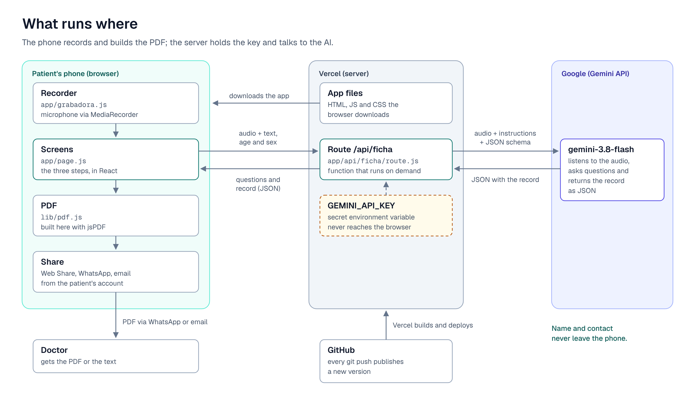
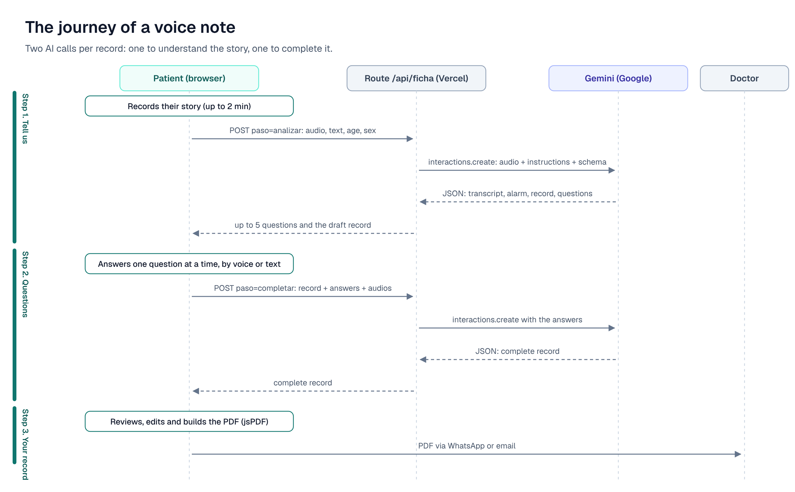

# PreConsulta

**Turn a voice note into a clean pre-visit medical record.** The patient tells their story out loud, an AI asks a few follow-up questions, and the result is a standard record (PDF) ready to send to the doctor.

**Live demo:** https://preconsulta-iota.vercel.app/ · **Article (Spanish):** [De un audio a una ficha médica](https://catherinebatres.substack.com/p/de-un-audio-a-una-ficha-medica-lo) · **Español:** [README.es.md](README.es.md)

> PreConsulta does not diagnose or recommend treatment. It only organizes what the patient says. All screenshots use made-up data.

<p>
  
  
  
</p>

## What it does

1. **Tell us.** The patient fills in general data and records up to 2 minutes describing what is wrong (or types it).
2. **Questions.** The AI listens, finds what is missing and asks up to 5 follow-up questions, one at a time. Each one is answered with a short voice note (up to 45 seconds) or text, or skipped.
3. **Your record.** The answers come back as a clinical-style sheet the patient can correct by tapping any field. It is shared as a PDF through the phone's share sheet (WhatsApp, email…), downloaded, or sent as plain text.

If the patient describes a warning sign such as chest pain, the app shows a red notice to seek emergency care.

<p>
  
  
</p>

## What runs where, and why



| Part | Runs on | Why there |
| --- | --- | --- |
| Screens (`app/page.js`) | The patient's browser | The app must open from a link on any phone, with nothing to install |
| Recorder (`app/grabadora.js`) | The patient's browser | The browser already has a microphone API (`MediaRecorder`) |
| PDF (`lib/pdf.js`) | The patient's browser | The record never has to travel back to a server to become a file |
| Share | The patient's browser and apps | It is sent from the patient's own WhatsApp or email account |
| Route `/api/ficha` (`app/api/ficha/route.js`) | Vercel, as a serverless function | It is the only place that knows the API key |
| `GEMINI_API_KEY` | Vercel environment variables (`.env.local` on your machine) | Anything in the browser can be read by anyone; the key must stay on the server |
| AI model `gemini-3.8-flash` | Google's servers, through the Gemini API | It understands audio and text in one call and returns structured JSON |

Data minimization is part of the design: **name and contact never leave the phone**. Only age, sex, the story and the answers are sent to the AI, and each AI call asks Google not to store the interaction (`store: false`). Nothing is saved in a database.

### The journey of a voice note

Each record uses two AI calls: one to understand the story and ask questions, one to complete the record with the answers.



## How the local component is called

"Local" here means the code that runs on the patient's device. The page calls it like any other function or React component, with no network involved.

**Recorder** — a React component that wraps `getUserMedia` + `MediaRecorder` and hands back the audio:

```jsx
import Grabadora from "./grabadora";

<Grabadora
  audio={audio}                 // { blob, url, tipo, duracion } or null
  onAudio={setAudio}            // called when a recording stops, or with null when deleted
  maxSegundos={45}              // stops automatically at the limit (default 120)
/>
```

It records in the first format the browser supports (`audio/webm` on Chrome and Android, `audio/mp4` on Safari/iPhone).

**PDF** — a plain async function that returns a `File`:

```js
import { crearArchivoPdf, precargarPdf } from "@/lib/pdf";

precargarPdf();                                     // optional: download jsPDF ahead of time
const archivo = await crearArchivoPdf(datos, ficha); // File, type application/pdf
```

`datos` is `{ nombre, edad, sexo, contacto }` and `ficha` is the record object described below.

**Record helpers** — `lib/ficha.js` defines the record's sections and fields once, so the AI schema, the screen and the PDF always match:

```js
import { SECCIONES, CAMPOS, fichaVacia, normalizarFicha, fichaComoTexto } from "@/lib/ficha";

fichaComoTexto(datos, ficha);                       // WhatsApp-ready text (*bold* headings)
fichaComoTexto(datos, ficha, { negritas: false });  // plain text for email
```

When you run the project with `npm run dev`, the server part also runs on your machine at `http://localhost:3000/api/ficha`.

## How each API is called

### 1. The app's own API: `POST /api/ficha`

The browser sends `multipart/form-data` (so audio travels as a binary file, not base64).

| Field | When | Content |
| --- | --- | --- |
| `paso` | always | `analizar` (first call) or `completar` (second call) |
| `edad`, `sexo` | always | Age and sex, optional |
| `texto` | `analizar` | The written story, up to 4,000 characters |
| `audio` | `analizar` | The recorded story (webm, mp4, ogg…) |
| `ficha` | `completar` | The current record, as JSON |
| `respuestas` | `completar` | JSON list of `{ pregunta, respuesta }` |
| `audio_0` … `audio_4` | `completar` | One optional voice answer per question |

Try it from a terminal while `npm run dev` is running:

```bash
curl -X POST http://localhost:3000/api/ficha \
  -F paso=analizar -F edad=34 -F sexo=Femenino \
  -F "texto=Desde hace tres días me duele la cabeza por las tardes"
# add a recording with:  -F "audio=@relato.webm;type=audio/webm"
```

Response:

```json
{
  "transcripcion": "",
  "alarma": "",
  "ficha": { "motivo": "Dolor de cabeza por las tardes", "inicio": "Hace tres días", "duracion": "", "...": "..." },
  "preguntas": ["¿Cuánto tiempo te dura el dolor cada vez?", "..."]
}
```

Errors come back as `{ "error": "<message in Spanish>" }` with status `400` (nothing to analyze), `413` (audio over 4 MB in total), `429` (AI usage limit), `500` (missing `GEMINI_API_KEY`) or `502` (the AI call failed).

### 2. The Gemini API (server only)

The route uses Google's official SDK, [`@google/genai`](https://www.npmjs.com/package/@google/genai), and its Interactions API:

```js
import { GoogleGenAI } from "@google/genai";

const ia = new GoogleGenAI({ apiKey: process.env.GEMINI_API_KEY });
const interaccion = await ia.interactions.create({
  model: process.env.GEMINI_MODEL || "gemini-3.8-flash",
  system_instruction: INSTRUCCIONES,          // rules: never diagnose, use only what was said...
  input: [
    { type: "text", text: "PASO: analizar\nDatos del paciente: ..." },
    { type: "audio", data: audioBase64, mime_type: "audio/webm" },
  ],
  response_format: { type: "text", mime_type: "application/json", schema: ESQUEMA },
  generation_config: { thinking_level: "low" }, // faster answers
  store: false,                                 // ask Google not to keep the interaction
});
const salida = JSON.parse(interaccion.output_text);
```

`ESQUEMA` is a JSON schema built from `lib/ficha.js` with four fields: `transcripcion`, `alarma`, `ficha` (13 text fields) and `preguntas` (up to 5). Asking for a schema instead of free text is what makes every record come back with the same sections in the same order.

### 3. Browser APIs

| API | Used for |
| --- | --- |
| `navigator.mediaDevices.getUserMedia` + `MediaRecorder` | Recording the voice notes |
| `navigator.share({ files: [pdf] })` (Web Share API) | Opening the phone's share sheet with the PDF attached; falls back to a download where unsupported |
| `https://wa.me/?text=…` | Sending the record as WhatsApp text (the patient picks the contact) |
| `mailto:?subject=…&body=…` | Sending the record as an email |

## Run it locally

You need [Node.js](https://nodejs.org) 20.9 or newer (22+ recommended) and a Gemini API key from [Google AI Studio](https://aistudio.google.com).

```bash
git clone https://github.com/CatherineBatres/preconsulta.git
cd preconsulta
npm install
```

Create a file named `.env.local` in the project root (it is ignored by git):

```
GEMINI_API_KEY=your_key_here
# optional: GEMINI_MODEL=gemini-3.8-flash
```

On Windows you can create it from the Command Prompt with `echo GEMINI_API_KEY=your_key_here> .env.local`.

```bash
npm run dev
```

Open http://localhost:3000. Restart `npm run dev` whenever you change `.env.local`.

## Run the tests

**Unit tests** check the record helpers in `lib/ficha.js` with Node's built-in test runner. No browser or key needed:

```bash
npm test
```

**End-to-end tests** open the real app in a phone-sized Chrome with a fake microphone and walk through the whole flow: recording, the three questions, the editable record, the PDF (checks it is a real PDF and its file name), the emergency notice and the error message when the AI hits its limit.

They never call Google: `tests/gemini-falso.mjs` is a small server that imitates the Gemini API, and Playwright points the app at it with `GOOGLE_GEMINI_BASE_URL`. The first time, install the test browser:

```bash
npx playwright install chromium
npm run test:e2e
```

The command builds the app, starts the fake AI on port 3222 and the app on port 3100, then runs `tests/e2e/preconsulta.spec.mjs`.

## Deploy

1. Push the repository to GitHub.
2. In [Vercel](https://vercel.com), choose **Add New → Project**, import the repository and keep the detected **Next.js** settings.
3. In **Settings → Environment Variables**, add `GEMINI_API_KEY`.
4. Deploy. From then on, every `git push` to `main` publishes a new version.

Environment variables only apply to new deployments: after adding or changing the key, redeploy.

## Recreate it from scratch

These are the steps used to build this repository, in order.

1. **Create the Next.js project** (JavaScript, Tailwind, App Router):

   ```bash
   npx create-next-app@latest preconsulta --js --tailwind --eslint --app --no-src-dir --import-alias "@/*" --use-npm
   cd preconsulta
   ```

2. **Add the two libraries** the app uses, plus Playwright for the tests:

   ```bash
   npm install @google/genai jspdf
   npm install -D @playwright/test
   ```

3. **Add the code**, file by file:

   | File | What it does |
   | --- | --- |
   | `lib/ficha.js` | The record's sections and fields, shared by the AI schema, the screen and the PDF |
   | `app/api/ficha/route.js` | Receives the story, calls Gemini with the instructions and schema, returns clean JSON |
   | `app/grabadora.js` | The record button and audio player |
   | `app/page.js` | The three steps: story, one-at-a-time questions, editable record and sharing |
   | `lib/pdf.js` | Builds the clinical-style PDF in the browser with jsPDF |
   | `app/layout.js` | Page title, language (`es`) and fonts |

4. **Add the tests**: `tests/unit/ficha.test.mjs`, `tests/gemini-falso.mjs`, `tests/e2e/preconsulta.spec.mjs` and `playwright.config.mjs`, then the scripts:

   ```bash
   npm pkg set scripts.test="node --test tests/unit/ficha.test.mjs" scripts.test:e2e="playwright test"
   ```

5. **Configure the key** in `.env.local`, run `npm run dev`, and deploy as described above.

## Project structure

```
preconsulta/
├── app/
│   ├── page.js               # the three steps
│   ├── grabadora.js          # recorder (MediaRecorder)
│   ├── layout.js             # title, language, fonts
│   └── api/ficha/route.js    # server route that calls Gemini
├── lib/
│   ├── ficha.js              # record sections and fields
│   └── pdf.js                # PDF generation (jsPDF)
├── tests/
│   ├── unit/ficha.test.mjs   # unit tests (node --test)
│   ├── e2e/preconsulta.spec.mjs  # end-to-end tests (Playwright)
│   └── gemini-falso.mjs      # fake Gemini API for the tests
├── docs/img/                 # screenshots and diagrams
├── playwright.config.mjs
├── .env.local                # your API key (not committed)
└── package.json
```

## Design decisions

- **Next.js on Vercel instead of Streamlit.** The first prototype was Streamlit (Python). It was switched on day two because the goal was a public link that works well on phones: free Streamlit apps go to sleep when idle, and mobile layout is hard to control.
- **One provider for audio and reasoning.** Gemini understands the audio directly, so there is no separate speech-to-text service.
- **A fixed JSON schema.** The record always has the same 13 fields, which the screen and the PDF can rely on.
- **No database.** Nothing to secure or delete later; the record lives in the page until the patient sends it.

## Limitations and future work

- Explicit consent before sending audio to an external AI.
- Protecting the API key on a public link: a spending cap and an access code or per-person limit.
- Sending the record straight to the clinic (WhatsApp Business API or an email service).
- Accounts and history to compare records across visits.

The article covers these in more detail.
